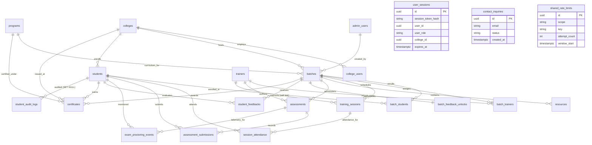

# College Training Management SaaS — Database Schema Reference

## 1. Relational Architecture & Overview

The database layer runs on **PostgreSQL 16+** (hosted via Neon Serverless Postgres). The schema comprises **22 relational tables** managed through Declarative SQLAlchemy 2.0 models and version-controlled via Alembic migrations (reconciled with baseline SQL scripts 001–019).

---

## 2. Mermaid Entity-Relationship (ER) Diagram

---

## 3. Detailed Table Specifications (22 Tables)

### 3.1 `admin_users`
Platform-level administrators with super_admin access.
- **Columns**:
  - `id`: `UUID`, Primary Key, default `gen_random_uuid()`
  - `email`: `VARCHAR(255)`, Unique, Not Null
  - `password_hash`: `VARCHAR(255)`, Not Null (Argon2id / Bcrypt)
  - `full_name`: `VARCHAR(255)`, Not Null
  - `role`: `VARCHAR(50)`, Not Null, default `'super_admin'`
  - `status`: `VARCHAR(50)`, Not Null, default `'active'`
  - `last_login_at`: `TIMESTAMPTZ`, Nullable
  - `created_at`: `TIMESTAMPTZ`, Not Null, default `NOW()`
  - `updated_at`: `TIMESTAMPTZ`, Not Null, default `NOW()`
- **Indexes**:
  - `idx_admin_users_email_lower`: Unique functional index on `LOWER(email)`
  - `idx_admin_users_role_status`: Composite on `(role, status)`

---

### 3.2 `colleges`
Partner institutions hosting vocational, undergraduate, and technical training.
- **Columns**:
  - `id`: `UUID`, Primary Key, default `gen_random_uuid()`
  - `name`: `TEXT`, Not Null
  - `city`: `TEXT`, Nullable
  - `state`: `TEXT`, Nullable
  - `contact_name`: `TEXT`, Nullable
  - `contact_email`: `TEXT`, Nullable
  - `contact_phone`: `TEXT`, Nullable
  - `logo_url`: `TEXT`, Nullable
  - `status`: `VARCHAR(20)`, Not Null, default `'active'`
  - `created_at`: `TIMESTAMPTZ`, Not Null, default `NOW()`
  - `updated_at`: `TIMESTAMPTZ`, Not Null, default `NOW()`
- **Constraints & Indexes**:
  - `chk_college_status`: `CHECK (status IN ('active', 'inactive'))`
  - `idx_colleges_name_city_lower`: Unique composite index on `(LOWER(TRIM(name)), LOWER(TRIM(COALESCE(city, ''))))`
  - `idx_colleges_status`: On `(status)`
  - `idx_colleges_created_at`: On `(created_at DESC)`

---

### 3.3 `college_users`
Institutional administrators scoped strictly to their parent college.
- **Columns**:
  - `id`: `UUID`, Primary Key, default `gen_random_uuid()`
  - `college_id`: `UUID`, Not Null, Foreign Key -> `colleges.id` (`ON DELETE CASCADE`)
  - `email`: `VARCHAR(255)`, Unique, Not Null
  - `password_hash`: `VARCHAR(255)`, Not Null
  - `full_name`: `VARCHAR(255)`, Not Null
  - `role`: `VARCHAR(50)`, Not Null, default `'college_admin'`
  - `phone`: `VARCHAR(50)`, Nullable
  - `status`: `VARCHAR(20)`, Not Null, default `'active'`
  - `last_login_at`: `TIMESTAMPTZ`, Nullable
  - `created_at`: `TIMESTAMPTZ`, Not Null, default `NOW()`
  - `updated_at`: `TIMESTAMPTZ`, Not Null, default `NOW()`
- **Constraints & Indexes**:
  - `chk_college_user_status`: `CHECK (status IN ('active', 'inactive'))`
  - `idx_college_users_email_lower`: Unique functional index on `LOWER(TRIM(email))`
  - `idx_college_users_college_id`: On `(college_id)`

---

### 3.4 `programs`
Master training curriculums (e.g. Python Full Stack, Data Science, AI/ML).
- **Columns**:
  - `id`: `UUID`, Primary Key, default `gen_random_uuid()`
  - `name`: `TEXT`, Not Null
  - `description`: `TEXT`, Nullable
  - `duration_days`: `INTEGER`, Not Null, default `0`
  - `progress_weights`: `JSONB`, Nullable, default `'{}'::jsonb`
  - `status`: `VARCHAR(20)`, Not Null, default `'active'`
  - `created_at`: `TIMESTAMPTZ`, Not Null, default `NOW()`
  - `updated_at`: `TIMESTAMPTZ`, Not Null, default `NOW()`
- **Constraints & Indexes**:
  - `chk_program_status`: `CHECK (status IN ('active', 'inactive'))`
  - `programs_duration_days_check`: `CHECK (duration_days >= 0)`
  - `idx_programs_name_lower`: Unique on `LOWER(TRIM(name))`

---

### 3.5 `batches`
Active training cohorts binding a college, curriculum, schedule, and trainers.
- **Columns**:
  - `id`: `UUID`, Primary Key, default `gen_random_uuid()`
  - `code`: `VARCHAR(100)`, Unique, Not Null
  - `college_id`: `UUID`, Not Null, Foreign Key -> `colleges.id` (`ON DELETE RESTRICT`)
  - `program_id`: `UUID`, Not Null, Foreign Key -> `programs.id` (`ON DELETE RESTRICT`)
  - `start_date`: `DATE`, Not Null
  - `end_date`: `DATE`, Not Null
  - `target_strength`: `INTEGER`, Not Null, default `0`
  - `status`: `VARCHAR(20)`, Not Null, default `'planned'`
  - `created_by`: `UUID`, Nullable, Foreign Key -> `admin_users.id` (`ON DELETE SET NULL`)
  - `created_at`: `TIMESTAMPTZ`, Not Null, default `NOW()`
  - `updated_at`: `TIMESTAMPTZ`, Not Null, default `NOW()`
- **Constraints & Indexes**:
  - `chk_batch_status`: `CHECK (status IN ('planned', 'active', 'completed', 'cancelled'))`
  - `chk_batch_dates`: `CHECK (end_date >= start_date)`
  - `batches_target_strength_check`: `CHECK (target_strength >= 0)`
  - `idx_batches_college_id`, `idx_batches_program_id`, `idx_batches_status`

---

### 3.6 `batch_students` (Association Table)
Maps enrolled students to training batches with enrollment timestamp and state.
- **Columns**:
  - `id`: `UUID`, Primary Key, default `gen_random_uuid()`
  - `batch_id`: `UUID`, Not Null, Foreign Key -> `batches.id` (`ON DELETE CASCADE`)
  - `student_id`: `UUID`, Not Null, Foreign Key -> `students.id` (`ON DELETE CASCADE`, constraint `fk_batch_students_student`)
  - `enrolled_at`: `TIMESTAMPTZ`, Not Null, default `NOW()`
  - `status`: `VARCHAR(20)`, Not Null, default `'enrolled'`
- **Constraints & Indexes**:
  - `unq_batch_student`: `UNIQUE (batch_id, student_id)`
  - `idx_batch_students_batch_id`, `idx_batch_students_student_id`

---

### 3.7 `batch_trainers` (Association Table)
Assigns instructors to batches with lead trainer designation.
- **Columns**:
  - `id`: `UUID`, Primary Key, default `gen_random_uuid()`
  - `batch_id`: `UUID`, Not Null, Foreign Key -> `batches.id` (`ON DELETE CASCADE`)
  - `trainer_id`: `UUID`, Not Null, Foreign Key -> `trainers.id` (`ON DELETE RESTRICT`, constraint `fk_batch_trainers_trainer`)
  - `assigned_at`: `TIMESTAMPTZ`, Not Null, default `NOW()`
  - `role`: `VARCHAR(50)`, Not Null, default `'lead_trainer'`
  - `is_lead`: `BOOLEAN`, Not Null, default `false`
- **Constraints & Indexes**:
  - `unq_batch_trainer`: `UNIQUE (batch_id, trainer_id)`
  - `idx_batch_trainers_one_lead_per_batch`: Partial unique index on `(batch_id) WHERE is_lead = true` (enforces strictly one lead trainer per batch)

---

### 3.8 `trainers`
Master instructor profiles with skill tags and authentication credentials.
- **Columns**:
  - `id`: `UUID`, Primary Key, default `gen_random_uuid()`
  - `full_name`: `VARCHAR(255)`, Not Null
  - `email`: `VARCHAR(255)`, Nullable
  - `phone`: `VARCHAR(50)`, Nullable
  - `skills`: `TEXT`, Nullable (comma-delimited tags)
  - `status`: `VARCHAR(20)`, Not Null, default `'active'`
  - `password_hash`: `VARCHAR(255)`, Nullable
  - `created_at`: `TIMESTAMPTZ`, Not Null, default `NOW()`
  - `updated_at`: `TIMESTAMPTZ`, Not Null, default `NOW()`
- **Constraints & Indexes**:
  - `chk_trainer_status`: `CHECK (status IN ('active', 'inactive'))`
  - `idx_trainers_email_lower`: Partial unique index on `LOWER(TRIM(email)) WHERE email IS NOT NULL AND TRIM(email) != ''`

---

### 3.9 `students`
Master student record holding academic profile, activation credentials, and lifecycle status.
- **Columns**:
  - `id`: `UUID`, Primary Key, default `gen_random_uuid()`
  - `college_id`: `UUID`, Nullable, Foreign Key -> `colleges.id` (`ON DELETE RESTRICT`)
  - `roll_number`: `VARCHAR(100)`, Not Null
  - `full_name`: `VARCHAR(255)`, Not Null
  - `email`: `VARCHAR(255)`, Nullable
  - `phone`: `VARCHAR(50)`, Nullable
  - `department`: `VARCHAR(100)`, Nullable
  - `year_or_semester`: `VARCHAR(50)`, Nullable
  - `dob`: `VARCHAR(20)`, Nullable (Format: `YYYY-MM-DD`)
  - `gender`: `VARCHAR(20)`, Nullable
  - `password_hash`: `VARCHAR(255)`, Nullable
  - `must_change_password`: `BOOLEAN`, Not Null, default `false`
  - `activation_token_hash`: `VARCHAR(255)`, Nullable (SHA-256 digest of 256-bit activation secret)
  - `activation_token_expires_at`: `TIMESTAMPTZ`, Nullable
  - `activated_at`: `TIMESTAMPTZ`, Nullable
  - `archived_at`: `TIMESTAMPTZ`, Nullable
  - `status`: `VARCHAR(20)`, Not Null, default `'active'`
  - `created_at`: `TIMESTAMPTZ`, Not Null, default `NOW()`
  - `updated_at`: `TIMESTAMPTZ`, Not Null, default `NOW()`
- **Constraints & Indexes**:
  - `idx_students_college_roll_lower`: Unique composite index on `(college_id, LOWER(TRIM(roll_number)))`
  - `idx_students_college_id`, `idx_students_email`, `idx_students_department`, `idx_students_status`

---

### 3.10 `training_sessions`
Scheduled daily classroom or lab sessions within a batch.
- **Columns**:
  - `id`: `UUID`, Primary Key, default `gen_random_uuid()`
  - `batch_id`: `UUID`, Not Null, Foreign Key -> `batches.id` (`ON DELETE CASCADE`)
  - `date`: `DATE`, Not Null
  - `start_time`: `TIME`, Nullable
  - `end_time`: `TIME`, Nullable
  - `topic`: `TEXT`, Nullable
  - `title`: `TEXT`, Not Null
  - `trainer_id`: `UUID`, Nullable (Soft ORM link without DB foreign key, per Migration 005)
  - `status`: `VARCHAR(20)`, Not Null, default `'scheduled'`
  - `created_at`: `TIMESTAMPTZ`, Not Null, default `NOW()`
  - `updated_at`: `TIMESTAMPTZ`, Not Null, default `NOW()`
- **Constraints & Indexes**:
  - `chk_session_status`: `CHECK (status IN ('scheduled', 'in_progress', 'completed', 'cancelled'))`
  - `chk_session_times`: `CHECK (end_time > start_time)`
  - `idx_sessions_batch_id`, `idx_sessions_date`, `idx_sessions_trainer_id`

---

### 3.11 `session_attendance`
Per-student attendance marks for a given training session.
- **Columns**:
  - `id`: `UUID`, Primary Key, default `gen_random_uuid()`
  - `session_id`: `UUID`, Not Null, Foreign Key -> `training_sessions.id` (`ON DELETE CASCADE`)
  - `student_id`: `UUID`, Not Null, Foreign Key -> `students.id` (`ON DELETE CASCADE`)
  - `status`: `VARCHAR(20)`, Not Null, default `'present'`
  - `notes`: `TEXT`, Nullable
  - `marked_at`: `TIMESTAMPTZ`, Not Null, default `NOW()`
- **Constraints & Indexes**:
  - `session_attendance_status_check`: `CHECK (status IN ('present', 'absent', 'late', 'excused'))`
  - `unq_session_student_attendance`: `UNIQUE (session_id, student_id)`
  - `idx_attendance_session_id`, `idx_attendance_student_id`, `idx_attendance_status`

---

### 3.12 `resources`
Curriculum materials, slide decks, and lab manuals linked to batches.
- **Columns**:
  - `id`: `UUID`, Primary Key, default `gen_random_uuid()`
  - `batch_id`: `UUID`, Not Null, Foreign Key -> `batches.id` (`ON DELETE CASCADE`)
  - `name`: `TEXT`, Not Null
  - `type`: `VARCHAR(50)`, Not Null, default `'google_drive'`
  - `url`: `TEXT`, Not Null
  - `description`: `TEXT`, Nullable
  - `created_at`: `TIMESTAMPTZ`, Not Null, default `NOW()`
  - `updated_at`: `TIMESTAMPTZ`, Not Null, default `NOW()`
- **Constraints & Indexes**:
  - `chk_resource_type`: `CHECK (type IN ('google_drive', 'document', 'video', 'link'))`
  - `idx_resources_batch_id`

---

### 3.13 `assessments`
Quizzes and tests with configurable schedules, durations, and JSONB question definitions.
- **Columns**:
  - `id`: `UUID`, Primary Key, default `gen_random_uuid()`
  - `batch_id`: `UUID`, Not Null, Foreign Key -> `batches.id` (`ON DELETE CASCADE`)
  - `title`: `VARCHAR(255)`, Not Null
  - `type`: `VARCHAR(50)`, Not Null, default `'quiz'`
  - `topic`: `VARCHAR(255)`, Nullable
  - `description`: `TEXT`, Nullable
  - `duration_minutes`: `INTEGER`, Not Null, default `30`
  - `total_marks`: `INTEGER`, Not Null, default `100`
  - `passing_marks`: `INTEGER`, Not Null, default `50`
  - `due_date`: `TIMESTAMPTZ`, Nullable
  - `status`: `VARCHAR(20)`, Not Null, default `'published'`
  - `trainer_id`: `UUID`, Nullable, Foreign Key -> `trainers.id` (`ON DELETE SET NULL`)
  - `start_time`: `TIMESTAMPTZ`, Nullable
  - `deadline`: `TIMESTAMPTZ`, Nullable
  - `shuffle_questions`: `BOOLEAN`, Not Null, default `true`
  - `anti_cheat_enabled`: `BOOLEAN`, Not Null, default `true`
  - `questions`: `JSONB`, Not Null, default `'[]'::jsonb`
  - `created_at`: `TIMESTAMPTZ`, Not Null, default `NOW()`
  - `updated_at`: `TIMESTAMPTZ`, Not Null, default `NOW()`
- **Constraints & Indexes**:
  - `chk_passing_marks`: `CHECK (passing_marks <= total_marks)`
  - `chk_total_marks`: `CHECK (total_marks > 0)`
  - `chk_duration`: `CHECK (duration_minutes > 0)`
  - `assessments_passing_marks_check`: `CHECK (passing_marks >= 0)`
  - `idx_assessments_batch_id`, `idx_assessments_status`, `idx_assessments_trainer_id`

---

### 3.14 `assessment_submissions`
Student examination attempt state, responses, autosaved progress, and final scores.
- **Columns**:
  - `id`: `UUID`, Primary Key, default `gen_random_uuid()`
  - `assessment_id`: `UUID`, Not Null, Foreign Key -> `assessments.id` (`ON DELETE CASCADE`)
  - `student_id`: `UUID`, Not Null, Foreign Key -> `students.id` (`ON DELETE CASCADE`)
  - `status`: `VARCHAR(30)`, Not Null, default `'submitted'`
  - `score`: `INTEGER`, Nullable
  - `feedback`: `TEXT`, Nullable
  - `submitted_at`: `TIMESTAMPTZ`, Nullable, default `NOW()`
  - `started_at`: `TIMESTAMPTZ`, Nullable, default `NOW()`
  - `answers`: `JSONB`, Nullable, default `'{}'::jsonb`
  - `violations_count`: `INTEGER`, Nullable, default `0`
  - `shuffled_question_order`: `JSONB`, Nullable
  - `version`: `INTEGER`, Not Null, default `1` (Optimistic locking for autosave concurrency)
- **Constraints & Indexes**:
  - `assessment_submissions_status_check`: `CHECK (status IN ('not_started', 'in_progress', 'submitted', 'evaluated', 'overdue'))`
  - `unq_student_assessment`: `UNIQUE (assessment_id, student_id)`
  - `idx_assessment_submissions_student`, `idx_assessment_submissions_lookup`

---

### 3.15 `exam_proctoring_events`
Audit trail of proctoring telemetry (tab switches, full-screen exits, connectivity drops).
- **Columns**:
  - `id`: `UUID`, Primary Key, default `gen_random_uuid()`
  - `assessment_id`: `UUID`, Not Null, Foreign Key -> `assessments.id` (`ON DELETE CASCADE`)
  - `student_id`: `UUID`, Not Null, Foreign Key -> `students.id` (`ON DELETE CASCADE`)
  - `event_type`: `VARCHAR(50)`, Not Null
  - `sequence_number`: `INTEGER`, Not Null, default `1`
  - `duration_seconds`: `NUMERIC(10, 2)`, Not Null, default `0.0`
  - `event_metadata`: `JSONB`, Not Null, default `'{}'::jsonb`
  - `acknowledged`: `BOOLEAN`, Not Null, default `true`
  - `idempotency_key`: `VARCHAR(128)`, Nullable
  - `created_at`: `TIMESTAMPTZ`, Not Null, default `NOW()`
- **Constraints & Indexes**:
  - `chk_proctoring_event_type`: `CHECK (event_type IN ('TAB_HIDDEN', 'WINDOW_BLUR', 'FULLSCREEN_EXIT', 'PAGE_HIDDEN', 'CONNECTION_LOST', 'CONNECTION_RESTORED', 'EXAM_RESUMED'))`
  - `idx_proctoring_events_idempotency`: Unique on `idempotency_key` (WHERE idempotency_key IS NOT NULL)

---

### 3.16 `batch_feedback_unlocks`
Governance state controlling when student feedback submission is permitted for a batch.
- **Columns**:
  - `id`: `UUID`, Primary Key, default `gen_random_uuid()`
  - `batch_id`: `UUID`, Unique, Not Null, Foreign Key -> `batches.id` (`ON DELETE CASCADE`)
  - `status`: `VARCHAR(20)`, Not Null, default `'unlocked'`
  - `unlocked_by_user_id`: `UUID`, Not Null
  - `unlocked_by_role`: `VARCHAR(50)`, Not Null
  - `unlocked_at`: `TIMESTAMPTZ`, Not Null, default `NOW()`
  - `created_at`: `TIMESTAMPTZ`, Not Null, default `NOW()`
  - `updated_at`: `TIMESTAMPTZ`, Not Null, default `NOW()`
- **Constraints & Indexes**:
  - `chk_feedback_unlock_status`: `CHECK (status IN ('locked', 'unlocked', 'closed'))`
  - `unq_batch_feedback_unlock`: `UNIQUE (batch_id)`

---

### 3.17 `student_feedbacks`
End-of-batch student reviews and numerical ratings (1–10).
- **Columns**:
  - `id`: `UUID`, Primary Key, default `gen_random_uuid()`
  - `batch_id`: `UUID`, Not Null, Foreign Key -> `batches.id` (`ON DELETE CASCADE`)
  - `student_id`: `UUID`, Not Null, Foreign Key -> `students.id` (`ON DELETE CASCADE`)
  - `rating`: `INTEGER`, Not Null
  - `comments`: `TEXT`, Not Null
  - `submitted_at`: `TIMESTAMPTZ`, Not Null, default `NOW()`
  - `created_at`: `TIMESTAMPTZ`, Not Null, default `NOW()`
  - `updated_at`: `TIMESTAMPTZ`, Not Null, default `NOW()`
- **Constraints & Indexes**:
  - `chk_student_feedback_rating`: `CHECK (rating >= 1 AND rating <= 10)`
  - `unq_student_batch_feedback`: `UNIQUE (batch_id, student_id)`

---

### 3.18 `certificates`
Cryptographically verifiable credentials issued upon meeting graduation criteria.
- **Columns**:
  - `id`: `UUID`, Primary Key, default `gen_random_uuid()`
  - `certificate_number`: `VARCHAR(64)`, Unique, Not Null, Index
  - `student_id`: `UUID`, Not Null, Foreign Key -> `students.id` (`ON DELETE CASCADE`)
  - `batch_id`: `UUID`, Not Null, Foreign Key -> `batches.id` (`ON DELETE CASCADE`)
  - `program_id`: `UUID`, Not Null, Foreign Key -> `programs.id` (`ON DELETE CASCADE`)
  - `college_id`: `UUID`, Not Null, Foreign Key -> `colleges.id` (`ON DELETE RESTRICT`)
  - `student_name`: `VARCHAR(255)`, Not Null
  - `student_roll`: `VARCHAR(100)`, Not Null
  - `college_name`: `VARCHAR(255)`, Not Null
  - `program_name`: `VARCHAR(255)`, Not Null
  - `attendance_rate`: `FLOAT`, Not Null, default `0.0`
  - `verification_code`: `VARCHAR(64)`, Unique, Not Null, Index
  - `status`: `VARCHAR(20)`, Not Null, default `'active'`
  - `issued_at`: `TIMESTAMPTZ`, Not Null, default `NOW()`
  - `created_at`: `TIMESTAMPTZ`, Not Null, default `NOW()`
  - `updated_at`: `TIMESTAMPTZ`, Not Null, default `NOW()`
- **Constraints & Indexes**:
  - `unq_student_batch_certificate`: `UNIQUE (student_id, batch_id)`

---

### 3.19 `user_sessions`
Server-side active sessions supporting polymorphic user identities and CSRF binding.
- **Columns**:
  - `id`: `UUID`, Primary Key, default `gen_random_uuid()`
  - `session_token_hash`: `VARCHAR(64)`, Unique, Not Null (SHA-256 digest)
  - `user_id`: `UUID`, Not Null
  - `user_role`: `VARCHAR(50)`, Not Null (`super_admin` | `college_admin` | `trainer` | `student`)
  - `college_id`: `UUID`, Nullable (Cached tenant reference)
  - `ip_address`: `VARCHAR(45)`, Nullable
  - `user_agent`: `TEXT`, Nullable
  - `created_at`: `TIMESTAMPTZ`, Not Null, default `NOW()`
  - `expires_at`: `TIMESTAMPTZ`, Not Null
  - `revoked_at`: `TIMESTAMPTZ`, Nullable
- **Indexes**:
  - `idx_user_sessions_token_hash`: Unique
  - `idx_user_sessions_user_lookup`: On `(user_id, user_role)`
  - `idx_user_sessions_expires_at`: On `(expires_at)`

---

### 3.20 `contact_inquiries`
Inbound enterprise, college, and corporate leads from public marketing pages.
- **Columns**:
  - `id`: `UUID`, Primary Key, default `gen_random_uuid()`
  - `name`: `VARCHAR(255)`, Not Null
  - `designation`: `VARCHAR(255)`, Nullable
  - `organization`: `VARCHAR(255)`, Not Null
  - `email`: `VARCHAR(255)`, Not Null
  - `phone`: `VARCHAR(50)`, Not Null
  - `requirement_type`: `VARCHAR(100)`, Not Null
  - `area_of_interest`: `VARCHAR(100)`, Nullable
  - `message`: `TEXT`, Nullable
  - `status`: `VARCHAR(20)`, Not Null, default `'new'`
  - `created_at`: `TIMESTAMPTZ`, Not Null, default `NOW()`
- **Constraints & Indexes**:
  - `chk_contact_inquiry_status`: `CHECK (status IN ('new', 'contacted', 'resolved', 'archived'))`
  - `idx_contact_inquiries_status`, `idx_contact_inquiries_created_at`

---

### 3.21 `student_audit_logs`
Immutable compliance log recording all student account mutations.
- **Columns**:
  - `id`: `UUID`, Primary Key, default `gen_random_uuid()`
  - `student_id`: `UUID`, Nullable, Foreign Key -> `students.id` (`ON DELETE SET NULL`)
  - `student_roll`: `VARCHAR(100)`, Not Null
  - `student_name`: `VARCHAR(255)`, Nullable
  - `college_id`: `UUID`, Nullable
  - `action`: `VARCHAR(50)`, Not Null
  - `actor_id`: `UUID`, Nullable
  - `actor_role`: `VARCHAR(50)`, Not Null, default `'system'`
  - `actor_email`: `VARCHAR(255)`, Nullable
  - `operation_id`: `VARCHAR(100)`, Nullable
  - `details`: `TEXT`, Nullable
  - `created_at`: `TIMESTAMPTZ`, Not Null, default `NOW()`
- **Database Trigger**:
  - `trg_prevent_audit_log_modification`: Enforces hard rejection of `DELETE` and unauthorized `UPDATE` statements via `prevent_audit_log_modification()` PostgreSQL function.

---

### 3.22 `shared_rate_limits`
Distributed atomic rate limiting table supporting multi-worker FastAPI instances.
- **Columns**:
  - `id`: `UUID`, Primary Key, default `uuid.uuid4`
  - `scope`: `VARCHAR(50)`, Not Null (`activation_ip` | `activation_roll`)
  - `key`: `VARCHAR(255)`, Not Null (Client IP or normalized Roll Number)
  - `attempt_count`: `INTEGER`, Not Null, default `1`
  - `window_start`: `TIMESTAMPTZ`, Not Null, default `NOW()`
  - `last_attempt_at`: `TIMESTAMPTZ`, Not Null, default `NOW()`
- **Constraints & Indexes**:
  - `uq_shared_rate_limits_scope_key`: `UNIQUE (scope, key)`
  - `idx_shared_rate_limits_scope_key`, `idx_shared_rate_limits_window`

---

## 4. Academic History Protection & Foreign Key Deletion Policy

To prevent accidental destruction of compliance or academic records, the database implements strict relational cascading boundaries:

1. **Foreign Key `RESTRICT` Constraints**:
   - `students.college_id` -> `colleges.id` (`ON DELETE RESTRICT`): Prevents deleting a college while enrolled students exist.
   - `batches.college_id` -> `colleges.id` (`ON DELETE RESTRICT`): Prevents deleting a college with active/historical batches.
   - `batches.program_id` -> `programs.id` (`ON DELETE RESTRICT`): Prevents deleting a program used by any batch.
   - `batch_trainers.trainer_id` -> `trainers.id` (`ON DELETE RESTRICT`): Prevents deleting a trainer assigned to any batch.

2. **Foreign Key `SET NULL` Constraints**:
   - `student_audit_logs.student_id` -> `students.id` (`ON DELETE SET NULL`): If an un-enrolled, un-tested student account is permanently deleted, the audit record remains completely intact with `student_roll`, `student_name`, `action`, `actor_role`, and `details`.

3. **Multi-Table Academic History Deletion Guard (Application Level)**:
   - Before executing permanent deletion of a student account, the backend verifies across **7 relational tables**:
     - `batch_students` (Enrollments)
     - `session_attendance` (Attendance marks)
     - `assessment_submissions` (Exams taken or in progress)
     - `exam_proctoring_events` (Anti-cheat events)
     - `student_feedbacks` (Course evaluations)
     - `certificates` (Issued credentials)
   - If ANY historical record exists, permanent deletion is **strictly rejected with HTTP 409 Conflict**. The administrator is instructed to archive the account instead.

