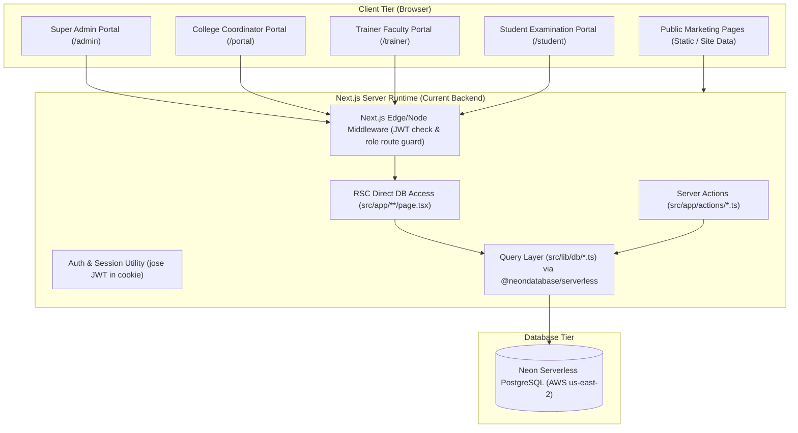
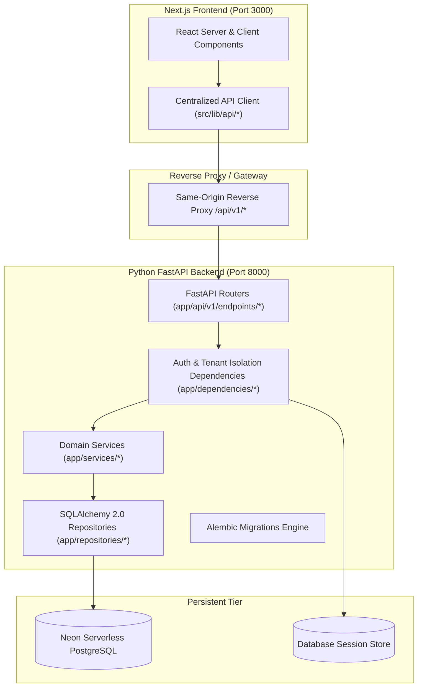

# Existing Architecture Document
## Project: Skill Mantra Academy / Skill Thinker Platform

---

## 1. System Overview

Skill Mantra Academy is an institutional training management and faculty development platform serving higher education institutions, faculty coordinators, trainers, and enrolled students.

The existing application is structured as a full-stack Next.js monolith deployed on Node.js/Serverless runtimes with a PostgreSQL database hosted on Neon Serverless.

---

## 2. Portals and Actors

The platform is partitioned into four major operational portals plus the public marketing website:

| Actor / Role | Portal Base Path | Primary Capabilities |
|---|---|---|
| **Super Admin** (`super_admin`) | `/admin` | System-wide governance; college creation; program master management; batch cohort scheduling; trainer registry & assignments; student enrollment & bulk CSV onboarding; platform-wide attendance & assessment monitoring. |
| **College Coordinator** (`college_admin`) | `/portal` | Institutional tenant dashboard; view college-specific batches, assigned trainers, enrolled students roster, session attendance rates, and cohort learning resources. |
| **Trainer / Faculty** (`trainer`) | `/trainer` | View assigned batch cohorts; live session attendance recording with student rosters; assessment/quiz scheduling (manual entry or CSV/Excel upload); question pool management; viewing student submission results and violations. |
| **Student** (`student`) | `/student` | Enrolled batch dashboard; course progress; daily training session schedule; attendance percentage tracking; interactive timed assessment/exam room with anti-cheat tracking; certificate eligibility verification. |
| **Public Visitor** (Anonymous) | `/`, `/about`, `/programs`, `/contact` | Course catalog exploration; institutional MoU inquiries; academic helpdesk chat widget. |

---

## 3. Current Implementation Mechanics

### 3.1 Data Flow & Querying Architecture
1. **Server Components (`RSC`)**: Page components in `src/app/admin/**`, `src/app/portal/**`, `src/app/trainer/**`, and `src/app/student/**` directly import query functions from `src/lib/db/*`. Database queries run directly during server rendering.
2. **Server Actions (`'use server'`)**: Mutations (creating colleges, adding batches, saving attendance, creating assessments, submitting exam answers) are executed as Next.js Server Actions in `src/app/actions/*.ts`.
3. **Database Client**: Uses `@neondatabase/serverless` via HTTPS SQL endpoint (`https://${host}/sql`). Queries are executed via parameterized SQL strings.
4. **Validation**: Handled via Zod schemas in `src/lib/validations/*.ts` on the Next.js server before executing queries.

### 3.2 Authentication & Session Flow
1. **Unified Login Query**: A single SQL query with `UNION ALL` across four separate tables (`admin_users`, `college_users`, `trainers`, `students`) checks email or roll number.
2. **Password Verification**: Plaintext passwords verified against bcrypt hashes (`bcryptjs`, 10 rounds).
3. **Session Cookie**: `skillmatra_session` HTTP-only cookie holding an HS256-signed JWT (`jose`) containing `{ id, email, fullName, role, collegeId, collegeName }`.
4. **Route Protection**: `src/middleware.ts` intercepts requests to `/admin/*`, `/portal/*`, `/trainer/*`, `/student/*`, verifying JWT and checking role strings.

---

## 4. Current Architectural Vulnerabilities & Deficiencies

1. **Tight Coupling to Next.js**: Business logic is fragmented across Server Actions (`src/app/actions/`), database helpers (`src/lib/db/`), and Server Components.
2. **Direct DB Reads in Frontend Components**: Over 40 Next.js Server Component files execute raw SQL queries against PostgreSQL.
3. **Stateless JWTs Without Revocation**: Sessions cannot be revoked server-side prior to JWT expiry (7 days). Session state is not stored in the database.
4. **Scattered Authorization Rules**: Role checks exist in middleware, but resource-level multi-tenant authorization (verifying that a trainer actually owns the batch or that a college coordinator owns the student) is inconsistently enforced across endpoints.
5. **Simulated / Mocked Workflows**:
   - Contact form (`ContactSection.tsx`): Uses `setTimeout` to simulate submission.
   - Academic chat widget (`InstitutionalChatWidget.tsx`): Uses `setTimeout` to simulate submission.
   - Certificate generation: Invokes `window.print()` instead of generating a tamper-proof official signed PDF.
6. **No OpenAPI Specification / API Contracts**: No external API interface exists for mobile apps, external integrations, or decoupled frontends.

---

## 5. Target FastAPI Architecture

The entire data access layer, authentication layer, and business logic will be removed from Next.js and re-architected into a Python FastAPI backend:

