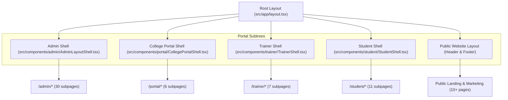

# College Training Management SaaS — Frontend Route & Component Inventory

## 1. Application Layout Shells & Navigation Hierarchy

The frontend is built on **Next.js 16 App Router** with **React 19** and **Tailwind CSS**. It provides dedicated layout wrappers for each user role:

---

## 2. Complete Next.js Route Catalog (64 Routes)

### 2.1 Super Admin Portal (`/admin/*`) — 30 Routes
| Route | Page File | Purpose & UI Capabilities |
| :--- | :--- | :--- |
| `/admin/dashboard` | `src/app/admin/dashboard/page.tsx` | Platform metrics, quick action cards, batch health counters, and system activity logs. |
| `/admin/colleges` | `src/app/admin/colleges/page.tsx` | Directory of partner institutions with status badges, city filters, and search. |
| `/admin/colleges/new` | `src/app/admin/colleges/new/page.tsx` | Multi-field college onboarding form with logo upload and contact specifications. |
| `/admin/colleges/[collegeId]` | `src/app/admin/colleges/[collegeId]/page.tsx` | Master college profile with overview tabs, address, and primary contacts. |
| `/admin/colleges/[collegeId]/edit` | `src/app/admin/colleges/[collegeId]/edit/page.tsx` | Institutional metadata and status editing. |
| `/admin/colleges/[collegeId]/batches` | `src/app/admin/colleges/[collegeId]/batches/page.tsx` | Sub-listing of all training batches hosted at this college. |
| `/admin/colleges/[collegeId]/batches/new` | `src/app/admin/colleges/[collegeId]/batches/new/page.tsx` | Create batch pre-bound to this college. |
| `/admin/colleges/[collegeId]/programs` | `src/app/admin/colleges/[collegeId]/programs/page.tsx` | Curriculums delivered at this college. |
| `/admin/colleges/[collegeId]/students` | `src/app/admin/colleges/[collegeId]/students/page.tsx` | Enrolled students belonging to this college. |
| `/admin/colleges/[collegeId]/trainers` | `src/app/admin/colleges/[collegeId]/trainers/page.tsx` | Instructors assigned to this college's cohorts. |
| `/admin/colleges/[collegeId]/reports` | `src/app/admin/colleges/[collegeId]/reports/page.tsx` | College-level attendance, assessment, and graduation metrics. |
| `/admin/programs` | `src/app/admin/programs/page.tsx` | Master curriculum list, module weight configurations, and program creation modal. |
| `/admin/batches` | `src/app/admin/batches/page.tsx` | Global batch directory with status filters (`planned`, `active`, `completed`), date ranges, and code search. |
| `/admin/batches/new` | `src/app/admin/batches/new/page.tsx` | Guided batch creation wizard. |
| `/admin/batches/[batchId]` | `src/app/admin/batches/[batchId]/page.tsx` | Batch overview hub with quick stats and tab navigation. |
| `/admin/batches/[batchId]/sessions` | `src/app/admin/batches/[batchId]/sessions/page.tsx` | Daily class schedule, session topics, and time slots. |
| `/admin/batches/[batchId]/students` | `src/app/admin/batches/[batchId]/students/page.tsx` | Batch student roster manager with CSV upload and manual enrollment. |
| `/admin/batches/[batchId]/trainers` | `src/app/admin/batches/[batchId]/trainers/page.tsx` | Assign/remove trainers, configure lead trainer flag. |
| `/admin/batches/[batchId]/attendance` | `src/app/admin/batches/[batchId]/attendance/page.tsx` | Batch attendance records, percentage calculations, and session drill-down. |
| `/admin/batches/[batchId]/assessments` | `src/app/admin/batches/[batchId]/assessments/page.tsx` | Quizzes and tests scheduled for this batch with submission counts. |
| `/admin/batches/[batchId]/feedback` | `src/app/admin/batches/[batchId]/feedback/page.tsx` | Batch feedback unlock toggle, student ratings, and sentiment reviews. |
| `/admin/batches/[batchId]/resources` | `src/app/admin/batches/[batchId]/resources/page.tsx` | Curated batch learning resources and drive links. |
| `/admin/batches/[batchId]/progress` | `src/app/admin/batches/[batchId]/progress/page.tsx` | Curriculum completion progress and milestone tracking. |
| `/admin/batches/[batchId]/reports` | `src/app/admin/batches/[batchId]/reports/page.tsx` | Batch final report card, eligibility calculation, and certificate issuance trigger. |
| `/admin/trainers` | `src/app/admin/trainers/page.tsx` | Master trainer directory with skill filters and active status. |
| `/admin/trainers/[trainerId]` | `src/app/admin/trainers/[trainerId]/page.tsx` | Trainer profile, contact info, assigned batches, and performance reviews. |
| `/admin/students` | `src/app/admin/students/page.tsx` | Central Student Management Hub: Roster Upload Wizard, Bulk Operations Modal, filters, and activation management. |
| `/admin/attendance` | `src/app/admin/attendance/page.tsx` | Platform-wide attendance overview and cross-college analytics. |
| `/admin/resources` | `src/app/admin/resources/page.tsx` | Global learning materials directory. |
| `/admin/reports` | `src/app/admin/reports/page.tsx` | Consolidated institutional reporting hub. |
| `/admin/users` | `src/app/admin/users/page.tsx` | Super Admin and College Admin user management, role assignment, and password resets. |

---

### 2.2 College Admin Portal (`/portal/*`) — 6 Routes
| Route | Page File | Purpose & UI Capabilities |
| :--- | :--- | :--- |
| `/portal` | `src/app/portal/page.tsx` | College Admin Dashboard: Institutional enrollment stats, active batches, and attendance trends strictly scoped to `session.collegeId`. |
| `/portal/batches` | `src/app/portal/batches/page.tsx` | College-specific batch list with status badges and creation shortcut. |
| `/portal/batches/[batchId]` | `src/app/portal/batches/[batchId]/page.tsx` | College-level view of batch sessions, roster, and progress. |
| `/portal/students` | `src/app/portal/students/page.tsx` | Scoped student roster management, CSV roster upload, and activation monitoring for this college only. |
| `/portal/trainers` | `src/app/portal/trainers/page.tsx` | Directory of trainers actively teaching at this college. |
| `/portal/resources` | `src/app/portal/resources/page.tsx` | College learning resources repository. |

---

### 2.3 Trainer Portal (`/trainer/*`) — 7 Routes
| Route | Page File | Purpose & UI Capabilities |
| :--- | :--- | :--- |
| `/trainer` | `src/app/trainer/page.tsx` | Trainer Dashboard: Today's scheduled sessions, active batches, and pending tasks. |
| `/trainer/batches` | `src/app/trainer/batches/page.tsx` | Batches assigned to the trainer with quick links to attendance and feedback. |
| `/trainer/attendance` | `src/app/trainer/attendance/page.tsx` | Batch selection for session attendance marking. |
| `/trainer/attendance/[batchId]` | `src/app/trainer/attendance/[batchId]/page.tsx` | Live interactive attendance roster with 1-click status buttons (`Present`, `Absent`, `Late`). |
| `/trainer/tests` | `src/app/trainer/tests/page.tsx` | Quiz authoring studio with JSON question parser, schedule deadlines, and proctoring logs. |
| `/trainer/batches/[batchId]/feedback` | `src/app/trainer/batches/[batchId]/feedback/page.tsx` | Batch feedback unlock controls and student review ratings. |
| `/trainer/profile` | `src/app/trainer/profile/page.tsx` | Trainer profile details, skill tags, and password change form. |

---

### 2.4 Student Portal (`/student/*`) — 11 Routes
| Route | Page File | Purpose & UI Capabilities |
| :--- | :--- | :--- |
| `/student` | `src/app/student/page.tsx` | Student Home Dashboard: Timetable, enrolled batch banner, attendance percentage, and pending tests. |
| `/student/course` | `src/app/student/course/page.tsx` | Course curriculum overview, syllabus topics, and learning objectives. |
| `/student/learning` | `src/app/student/learning/page.tsx` | Classroom sessions timetable and study schedule. |
| `/student/learning/[batchId]` | `src/app/student/learning/[batchId]/page.tsx` | Batch-specific learning modules and class recordings. |
| `/student/schedule` | `src/app/student/schedule/page.tsx` | Interactive calendar of upcoming lectures and assessments. |
| `/student/attendance` | `src/app/student/attendance/page.tsx` | Detailed personal attendance history, session marks, and percentage indicator. |
| `/student/resources` | `src/app/student/resources/page.tsx` | Downloadable study materials, presentation slides, and lab assignments. |
| `/student/tests` | `src/app/student/tests/page.tsx` | Active and upcoming quizzes list with duration, deadlines, and past attempt scores. |
| `/student/tests/[assessmentId]` | `src/app/student/tests/[assessmentId]/page.tsx` | Full-screen proctored examination room with anti-cheat telemetry and autosave. |
| `/student/certificates` | `src/app/student/certificates/page.tsx` | Graduation credential viewer, feedback completion check, and PDF certificate download with celebration confetti. |
| `/student/profile` | `src/app/student/profile/page.tsx` | Student personal details, roll number, college name, and password update. |

---

### 2.5 Public & Marketing Routes — 10+ Routes
| Route | Page File | Purpose & UI Capabilities |
| :--- | :--- | :--- |
| `/` | `src/app/page.tsx` | Main marketing landing page with hero, statistics, curriculum highlights, and inquiry form. |
| `/about` | `src/app/about/page.tsx` | Company background, founder bio, mission, and pedagogy. |
| `/contact` | `src/app/contact/page.tsx` | Contact inquiry form with real database persistence in `contact_inquiries`. |
| `/for-institutions` | `src/app/for-institutions/page.tsx` | Value proposition and onboarding details for universities and colleges. |
| `/for-corporates` | `src/app/for-corporates/page.tsx` | Corporate skill training and enterprise upskilling programs. |
| `/student-development` | `src/app/student-development/page.tsx` | Campus recruitment training and technical bootcamps. |
| `/faculty-development` | `src/app/faculty-development/page.tsx` | Faculty enablement and train-the-trainer workshops. |
| `/programs` | `src/app/programs/page.tsx` | Public catalog of technology training tracks. |
| `/events` | `src/app/events/page.tsx` | Upcoming hackathons, bootcamps, and webinars. |
| `/resources` | `src/app/resources/page.tsx` | Public articles, syllabus whitepapers, and guides. |
| `/privacy` | `src/app/privacy/page.tsx` | SaaS privacy policy and data retention disclosures. |
| `/terms` | `src/app/terms/page.tsx` | Institutional terms of service and compliance clauses. |
| `/login` | `src/app/login/page.tsx` | Central multi-role login portal (Super Admin, College Admin, Trainer, and Student Roll/DOB activation). |
| `/verify/[code]` | `src/app/verify/[code]/page.tsx` | Public cryptographic certificate verification engine with live authenticity status. |

---

## 3. Component Directory Catalog

### 3.1 Super Admin Components (`src/components/admin/`) — 50+ Files
- **Layout & Navigation**:
  - `AdminLayoutShell.tsx`: Root admin container with collapsible sidebar and mobile drawer.
  - `AdminSidebar.tsx`: Navigation menu with active item highlight, badge counts, and icon mapping.
  - `AdminHeader.tsx`: Top bar with search trigger, notifications icon, and user dropdown.
  - `AdminAvatarDropdown.tsx`: Profile menu with sign-out action and password change trigger.
  - `AdminCommandPalette.tsx`: Global search modal (`Ctrl+K` / `Cmd+K`) across colleges, batches, and students.
  - `Breadcrumbs.tsx`: Dynamic breadcrumb trails based on route hierarchy.
  - `PageHeader.tsx`: Consistent title, description, and primary call-to-action button strip.
  - `AdminProgressBar.tsx`: Top loading progress indicator during page transitions.
  - `AdminToast.tsx`: Toast notifications for async server actions.
- **Student Lifecycle & Bulk Operations**:
  - `RosterUploadWizardModal.tsx`: Multi-step CSV/Excel student roster upload wizard with validation preview and auto-provisioning.
  - `BulkStudentActionModal.tsx`: Bulk action dialog (deactivate, reactivate, revoke sessions, reset activation, archive, permanent delete) with 7-table academic history checks.
  - `SingleStudentModal.tsx`: Add/edit individual student dialog.
  - `StudentsDirectoryClient.tsx`: Student management directory with search, filter tabs, bulk selection checkboxes, and action toolbars.
  - `StudentRosterManager.tsx`: Batch-level student roster table with add/remove actions.
  - `StudentCsvUploadModal.tsx`: Batch-level CSV enrollment modal.
- **College & Program Management**:
  - `CollegesDirectoryClient.tsx`: Interactive college cards with search and city filter.
  - `CollegeForm.tsx`: College registration and edit form.
  - `CollegeTabs.tsx`: Tab navigation for college subpages.
  - `CollegeStudentsList.tsx`, `CollegeTrainersList.tsx`, `CollegeProgramsTab.tsx`: Tab views for college details.
  - `ProgramsListClient.tsx` & `ProgramModal.tsx`: Curriculum list and modal editor.
- **Batch Management**:
  - `BatchesDirectoryClient.tsx`: Batch directory with status filters and code search.
  - `BatchForm.tsx`: Batch scheduling form.
  - `GuidedBatchCreationWizard.tsx` & `QuickCreateBatchModal.tsx`: Multi-step batch creation flows.
  - `BatchTabs.tsx`: Batch navigation tab bar.
  - `BatchAttendanceManager.tsx`: Batch attendance review and calendar.
  - `BatchTrainersManager.tsx`: Trainer assignment and lead instructor selector.
  - `BatchFeedbackManager.tsx`: Feedback unlock controls and reviews summary.
  - `BatchResourcesSection.tsx` & `ResourceModal.tsx`: Resource management.
- **Users & Administration**:
  - `AdminUsersClient.tsx`: Super Admin and College Admin user management list.
  - `UserModal.tsx`: Modal to invite or edit admin users.
  - `SecureDeleteModal.tsx`: Destructive action confirmation modal.
  - `StatCard.tsx`, `StatusBadge.tsx`, `EmptyState.tsx`: Reusable data display widgets.

---

### 3.2 College Admin Components (`src/components/portal/`)
- `CollegePortalShell.tsx`: Dedicated shell scoped to college admin context.
- `CollegePortalHeader.tsx`: College admin header with college branding.
- `CollegePortalSidebar.tsx`: Navigation menu restricted to college admin capabilities.
- `CollegePortalDashboard.tsx`: Dashboard with enrollment and batch KPIs.
- `CollegePortalStudentsClient.tsx`: Student roster view scoped to college.

---

### 3.3 Trainer Components (`src/components/trainer/`)
- `TrainerShell.tsx`: Responsive layout wrapper for trainer portal.
- `TrainerNav.tsx`: Navigation bar for trainer modules.
- `TrainerAvatarDropdown.tsx`: Trainer user dropdown.
- `TrainerBatchesClient.tsx`: Interactive batch cards for instructors.
- `LiveAttendanceClient.tsx`: Interactive class attendance marking sheet.
- `TrainerTestsClient.tsx`: Quiz builder and proctoring log inspector.
- `Card.tsx`, `EmptyState.tsx`: Trainer UI primitives.

---

### 3.4 Student Components (`src/components/student/`)
- `StudentShell.tsx`: Student portal layout with bottom nav on mobile.
- `StudentNav.tsx`: Top header navigation with course progress indicator.
- `UserAvatarDropdown.tsx`: Student profile dropdown.
- `FullScreenExamRoom.tsx`: Dedicated proctored exam engine with fullscreen lock and event telemetry.
- `QuizRoomModal.tsx`: Quiz launch dialog with instructions and duration timer.
- `TestsClient.tsx`: Student test list with status indicators (`Pending`, `In Progress`, `Completed`).
- `StudentFeedbackModal.tsx` & `StudentFeedbackBanner.tsx`: Course rating and review dialog.
- `CertificateDownloadButton.tsx`: Client-side trigger for vector PDF generation with confetti celebration.
- `CertificateFeedbackTrigger.tsx`: Enforces feedback submission before certificate download.
- `StatBlock.tsx`, `ProgressBar.tsx`, `StatusDot.tsx`, `Skeleton.tsx`: Reusable student UI widgets.

---

### 3.5 Public & Marketing Components (`src/components/sections/` & `layout/`)
- `Header.tsx` & `Footer.tsx`: Global navigation header and institutional footer.
- `HeroSection.tsx`: Landing page hero with CTA triggers.
- `InstitutionalSection.tsx`: University partnership showcase.
- `CorporateTrainingSection.tsx`: Enterprise training track details.
- `StudentDevelopmentSection.tsx`: Bootcamps and placements showcase.
- `FacultyDevelopmentSection.tsx`: Faculty development program details.
- `ProgramsDiscoverySection.tsx`: Interactive technology domain selector.
- `ContactSection.tsx`: Inbound inquiry form with validation.
- `ImpactSection.tsx`, `PartnersSection.tsx`, `FounderSection.tsx`, `TrustStrip.tsx`: Social proof and institutional authority sections.
- `InstitutionalChatWidget.tsx` (`src/components/ui/`): Floating chat lead generator widget.

---

## 4. Next.js Server Actions Inventory (`src/app/actions/*`) — 13 Files

| Server Action File | Primary Exported Functions | Backend Endpoints Invoked |
| :--- | :--- | :--- |
| `auth.ts` | `loginAction`, `logoutAction`, `studentLoginAction`, `studentActivateAction`, `getCurrentSession` | `/api/v1/auth/login`, `/api/v1/auth/student-login`, `/api/v1/auth/student-activate`, `/api/v1/auth/logout` |
| `adminUsers.ts` | `getAdminUsersAction`, `createAdminUserAction`, `toggleUserStatusAction`, `resetPasswordAction` | `/api/v1/admin/users`, `/api/v1/admin/users/{id}/status`, `/api/v1/admin/users/{id}/reset-password` |
| `colleges.ts` | `getCollegesAction`, `createCollegeAction`, `updateCollegeAction`, `deleteCollegeAction` | `/api/v1/colleges/`, `/api/v1/colleges/{id}` |
| `programs.ts` | `getProgramsAction`, `createProgramAction`, `updateProgramAction`, `deleteProgramAction` | `/api/v1/programs/`, `/api/v1/programs/{id}` |
| `batches.ts` | `getBatchesAction`, `createBatchAction`, `updateBatchAction`, `updateBatchStatusAction` | `/api/v1/batches/`, `/api/v1/batches/{id}`, `/api/v1/batches/{id}/status` |
| `students.ts` | `getStudentsAction`, `createStudentAction`, `previewRosterAction`, `importRosterAction`, `bulkStudentAction`, `previewBulkDeleteAction` | `/api/v1/students/`, `/api/v1/students/roster-preview`, `/api/v1/students/roster-import`, `/api/v1/students/bulk-action`, `/api/v1/students/bulk-delete-preview` |
| `trainers.ts` | `getTrainersAction`, `createTrainerAction`, `updateTrainerAction`, `assignTrainerAction` | `/api/v1/trainers/`, `/api/v1/trainers/{id}`, `/api/v1/trainers/{id}/assign` |
| `attendance.ts` | `getBatchAttendanceAction`, `saveSessionAttendanceAction`, `getStudentAttendanceAction` | `/api/v1/attendance/batch/{id}`, `/api/v1/attendance/student/{id}` |
| `trainerAttendance.ts`| `getLiveRosterAction`, `saveLiveRosterAction` | `/api/v1/attendance/batch/{batch_id}` |
| `trainerQuizzes.ts`| `getTrainerQuizzesAction`, `createQuizAction`, `updateQuizAction`, `deleteQuizAction` | `/api/v1/assessments/`, `/api/v1/assessments/{id}` |
| `studentQuiz.ts` | `getAvailableQuizzesAction`, `startExamAction`, `autosaveExamAction`, `submitExamAction`, `logProctoringEventAction` | `/api/v1/assessments/student/available`, `/api/v1/assessments/{id}/start`, `/api/v1/assessments/{id}/autosave`, `/api/v1/assessments/{id}/submit`, `/api/v1/assessments/{id}/proctoring-event` |
| `feedback.ts` | `getFeedbackStatusAction`, `unlockFeedbackAction`, `submitFeedbackAction`, `getFeedbackReviewsAction` | `/api/v1/feedback/batch/{id}/status`, `/api/v1/feedback/batch/{id}/unlock`, `/api/v1/feedback/batch/{id}/submit`, `/api/v1/feedback/batch/{id}/reviews` |
| `resources.ts` | `getBatchResourcesAction`, `addResourceAction`, `deleteResourceAction` | `/api/v1/resources/batch/{id}`, `/api/v1/resources/{id}` |

