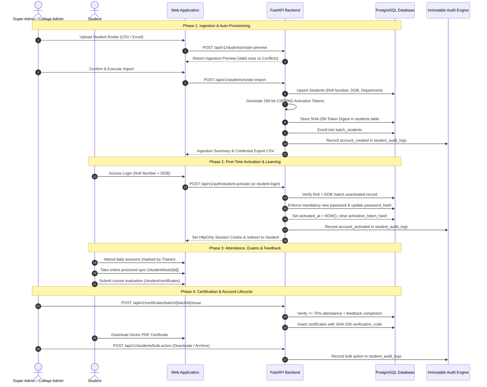
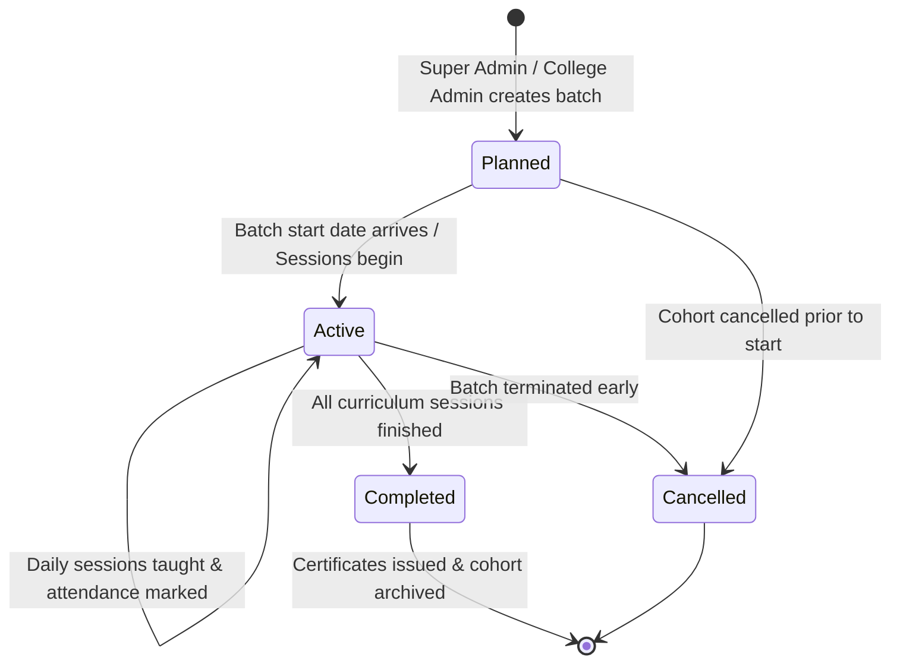
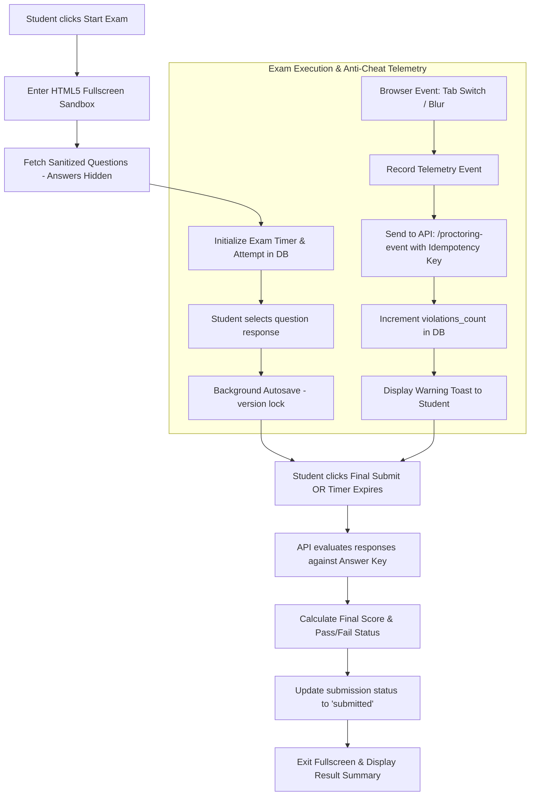

# College Training Management SaaS — Module & Workflow Documentation

## 1. End-to-End Business Workflows

### 1.1 Complete Student Account & Academic Lifecycle

The complete student journey spans from institutional roster ingestion to graduation credential issuance and protected account retirement:

#### Step-by-Step Lifecycle Explanation
1. **Roster Ingestion**: An administrator uploads an Excel or CSV file containing student demographics (Roll Number, Full Name, Email, Phone, Department, Semester, DOB). The system normalizes roll numbers and email addresses and displays a validation preview distinguishing brand new students from existing profiles.
2. **Automated Account Provisioning**: Upon administrator confirmation, student records are created in a single database transaction. Secure initial activation tokens (generated using `secrets.token_urlsafe(32)` providing 256 bits of entropy) are created, SHA-256 hashed, and stored. The unactivated accounts have `must_change_password = true`.
3. **Batch Enrollment**: The provisioned students are immediately linked to the specified batch in `batch_students`.
4. **First-Time Activation**: The student accesses `/login` and provides their Roll Number and DOB (or activation token). The application verifies their credentials and prompts them to establish a strong private password. Upon saving, the activation token is invalidated, `activated_at` is timestamped, and a student session is established.
5. **Classroom Learning & Attendance**: Instructors mark attendance for scheduled sessions. The student's live dashboard reflects their cumulative attendance percentage against the 75% institutional requirement.
6. **Proctored Examination**: The student launches scheduled assessments in a secure full-screen browser sandbox. Violations such as exiting fullscreen, switching tabs, or losing window focus are automatically logged to `exam_proctoring_events` with monotonic sequence numbers. Student answers are autosaved periodically with optimistic concurrency checks.
7. **Course Feedback**: Once the batch feedback window is unlocked by the administrator or trainer, the student submits a numerical rating (1–10) and feedback review. Duplicate submissions are prevented.
8. **Graduation & Certification**: Students with at least 75% attendance who have submitted feedback become eligible for graduation. The administrator executes batch certification, generating immutable certificate records with unique alphanumeric codes and SHA-256 verification hashes. The student downloads an official ReportLab vector PDF certificate.
9. **Account Retirement & Protected Deletion**: When a cohort concludes, accounts can be deactivated, sessions revoked, or archived. If permanent deletion is requested, the application checks 7 historical tables (`batch_students`, `session_attendance`, `assessment_submissions`, `exam_proctoring_events`, `student_feedbacks`, `certificates`). If any historical data exists, permanent deletion is aborted with a 409 Conflict, preserving academic integrity.

---

### 1.2 Academic Batch Scheduling & Classroom Progression

1. **Curriculum Design**: Super Admin defines the master training program in `programs`, configuring duration in days and module weights.
2. **Cohort Provisioning**: An administrator creates a batch under a specific college and program, setting start and end dates and target student strength.
3. **Faculty Assignment**: Instructors are bound to the cohort via `batch_trainers`. Exactly one instructor is designated as the `is_lead = true` trainer (enforced by a PostgreSQL partial unique index).
4. **Session Scheduling**: Daily class and laboratory sessions are generated in `training_sessions` with date, time bounds, and syllabus topics.
5. **Live Classroom Delivery**: Instructors conduct class, launch the interactive live attendance roster, and mark each student as `present`, `absent`, `late`, or `excused`.
6. **Curriculum Completion**: When all sessions conclude, the batch status is updated to `completed`, locking session modifications and preparing for certificate issuance.

---

### 1.3 Online Examination & Proctoring Safeguards

---

## 2. Comprehensive Module Breakdowns

### 2.1 College Management Module
- **Purpose**: Manage institutional relationships, campus locations, primary administrative points of contact, and institutional logos.
- **User Roles**: Super Admin (full CRUD), College Admin (read and scoped edit).
- **Frontend Screens**: `/admin/colleges`, `/admin/colleges/new`, `/admin/colleges/[collegeId]`, `/admin/colleges/[collegeId]/edit`.
- **Backend APIs**: `GET/POST /api/v1/colleges/`, `GET/PUT/DELETE /api/v1/colleges/{id}`, `GET /api/v1/colleges/{id}/batches`.
- **Database Tables**: `colleges`, `college_users`.
- **Key Validation Rules**:
  - College name + city must be unique across the platform (`idx_colleges_name_city_lower`).
  - Cannot delete a college if any active or historical batches or students reference it (`ON DELETE RESTRICT`).

---

### 2.2 Program & Curriculum Management Module
- **Purpose**: Define master training courses, duration parameters, syllabus topics, and module weighting.
- **User Roles**: Super Admin (full CRUD), College Admin & Trainers (read-only).
- **Frontend Screens**: `/admin/programs`.
- **Backend APIs**: `GET/POST /api/v1/programs/`, `GET/PUT/DELETE /api/v1/programs/{id}`.
- **Database Tables**: `programs`.
- **Key Validation Rules**:
  - Program name must be unique.
  - Duration days must be non-negative (`duration_days >= 0`).
  - Deletion restricted if referenced by batches.

---

### 2.3 Batch Management Module
- **Purpose**: Manage individual training cohorts, start/end dates, target strength, assigned instructors, and student rosters.
- **User Roles**: Super Admin (global), College Admin (scoped to college), Trainer (assigned batches only).
- **Frontend Screens**: `/admin/batches/*`, `/portal/batches/*`, `/trainer/batches/*`.
- **Backend APIs**: `GET/POST /api/v1/batches/`, `GET/PUT/DELETE /api/v1/batches/{id}`, `PATCH /api/v1/batches/{id}/status`.
- **Database Tables**: `batches`, `batch_students`, `batch_trainers`.
- **Key Validation Rules**:
  - Batch code must be unique across the system.
  - End date must be greater than or equal to start date (`end_date >= start_date`).
  - Target strength must be non-negative.
  - Strictly one lead trainer per batch (`idx_batch_trainers_one_lead_per_batch`).

---

### 2.4 Student Management & Account Provisioning Module
- **Purpose**: Student directory, CSV/Excel roster import, automatic account provisioning, 256-bit activation token generation, bulk lifecycle actions, and protected account deletion.
- **User Roles**: Super Admin (global), College Admin (scoped to college).
- **Frontend Screens**: `/admin/students`, `/portal/students`.
- **Backend APIs**: `GET/POST /api/v1/students/`, `POST /api/v1/students/roster-preview`, `POST /api/v1/students/roster-import`, `POST /api/v1/students/bulk-action`, `POST /api/v1/students/bulk-delete-preview`.
- **Database Tables**: `students`, `student_audit_logs`, `shared_rate_limits`, `user_sessions`.
- **Key Validation Rules**:
  - Roll number is unique per college (`idx_students_college_roll_lower`).
  - Activation tokens have 256 bits of cryptographic entropy and expire in 72 hours.
  - Distributed rate limiting enforced via PostgreSQL row locks (`shared_rate_limits`).
  - Permanent deletion is strictly blocked if historical records exist in any of 7 tables.
  - Audit logs are database-level immutable via trigger `prevent_audit_log_modification`.

---

### 2.5 Training Sessions & Live Attendance Module
- **Purpose**: Schedule daily classes, track curriculum progression, and record student attendance.
- **User Roles**: Super Admin, College Admin, Trainer (marking), Student (viewing).
- **Frontend Screens**: `/admin/batches/[id]/sessions`, `/trainer/attendance/[batchId]`, `/student/attendance`.
- **Backend APIs**: `GET/POST /api/v1/sessions/`, `GET/POST /api/v1/attendance/batch/{id}`.
- **Database Tables**: `training_sessions`, `session_attendance`.
- **Key Validation Rules**:
  - Session end time must be after start time (`end_time > start_time`).
  - Status must be `present`, `absent`, `late`, or `excused`.
  - Exactly one attendance mark per student per session (`unq_session_student_attendance`).

---

### 2.6 Assessment & Anti-Cheat Proctoring Module
- **Purpose**: Author quizzes with JSON questions, enforce browser fullscreen sandboxing, record real-time telemetry violations, autosave responses, and auto-evaluate submissions.
- **User Roles**: Trainer (authoring & review), Student (taking test), Admin (oversight).
- **Frontend Screens**: `/trainer/tests`, `/student/tests`, `/student/tests/[assessmentId]`.
- **Backend APIs**: `GET/POST/PUT /api/v1/assessments/`, `POST /api/v1/assessments/{id}/start`, `POST /api/v1/assessments/{id}/autosave`, `POST /api/v1/assessments/{id}/submit`, `POST /api/v1/assessments/{id}/proctoring-event`.
- **Database Tables**: `assessments`, `assessment_submissions`, `exam_proctoring_events`.
- **Key Validation Rules**:
  - Total marks must be positive; passing marks must be <= total marks.
  - Autosave updates require monotonic `version` matches (optimistic locking).
  - Telemetry event ingestion requires valid `idempotency_key` to avoid duplicate counts.
  - Correct answers are stripped from payload until submission is evaluated.

---

### 2.7 Feedback & Certification Module
- **Purpose**: Control feedback collection window, gather student ratings and reviews, evaluate graduation eligibility, and generate verifiable vector PDF certificates.
- **User Roles**: Admin / Trainer (unlocking & review), Student (submitting & downloading), Public (verification).
- **Frontend Screens**: `/admin/batches/[id]/feedback`, `/student/certificates`, `/verify/[code]`.
- **Backend APIs**: `GET/POST /api/v1/feedback/*`, `GET/POST /api/v1/certificates/*`, Next.js Route `/api/certificates/[batchId]/download`.
- **Database Tables**: `batch_feedback_unlocks`, `student_feedbacks`, `certificates`.
- **Key Validation Rules**:
  - Feedback rating must be between 1 and 10 (`chk_student_feedback_rating`).
  - One feedback submission per student per batch (`unq_student_batch_feedback`).
  - Certificate issuance requires feedback submission and >= 75% attendance.
  - Certificate numbers and SHA-256 verification codes must be globally unique.

