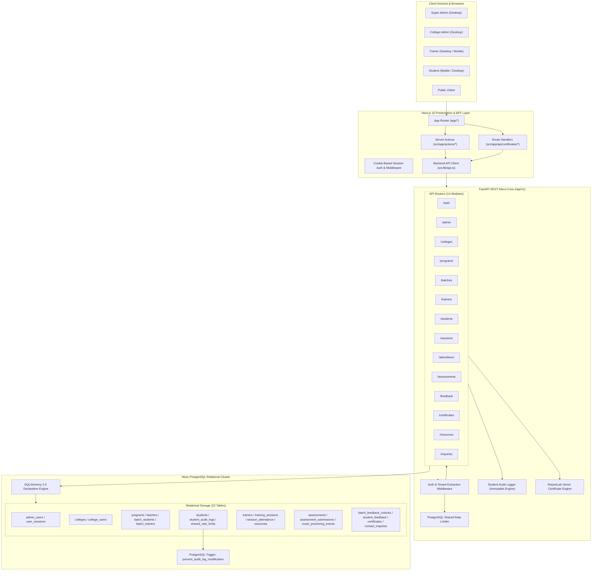
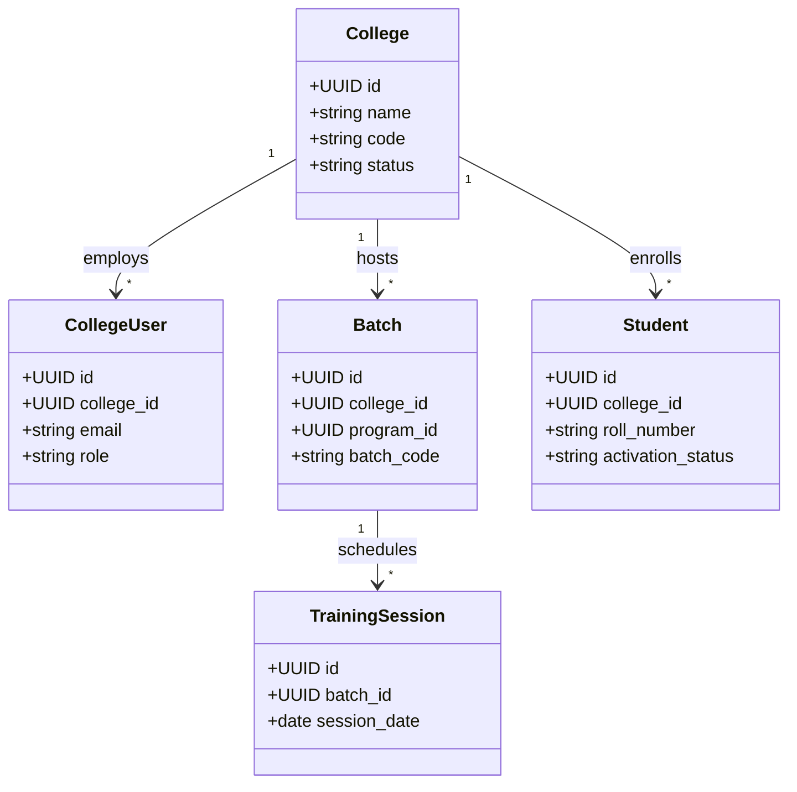
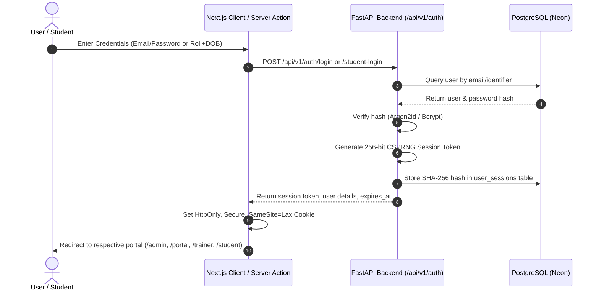

# College Training Management SaaS — System Architecture Reference

## 1. Executive Summary & Application Purpose

The **College Training Management SaaS Platform** is a multi-tenant enterprise training operations system designed for vocational training providers, universities, and enterprise skill academies. The platform orchestrates the end-to-end training lifecycle across four distinct stakeholder groups:
1. **Super Admins**: System-wide platform administrators managing partner institutions, academic programs, master trainers, batch scheduling, platform analytics, student roster ingestion, and bulk account lifecycles.
2. **College Admins**: Institutional administrators overseeing training programs, batch operations, roster validation, student activation, and attendance/performance metrics strictly scoped to their assigned college.
3. **Trainers**: Instructors conducting training sessions, marking attendance, executing curriculum milestones, publishing assessments/quizzes, and reviewing batch-level feedback.
4. **Students**: Learners accessing personalized daily schedules, class materials, live assessment engines with proctoring safeguards, feedback submission, attendance histories, and cryptographic certificate issuance.

---

## 2. Technology Stack

### 2.1 Frontend Architecture
| Layer | Technology | Specification / Version |
| :--- | :--- | :--- |
| **Framework** | Next.js App Router | Next.js 16.0.0 (Node 20+ compatible) |
| **UI Library** | React | React 19.0.0 (Server Components + Client Components) |
| **Language** | TypeScript | TypeScript 5.5+ (Strict Type Checking) |
| **Styling** | Tailwind CSS | Tailwind CSS 3.4+ with custom design system |
| **Icons** | Lucide React | Lucide React 0.450+ |
| **Animations / Effects** | Canvas Confetti | canvas-confetti (Certificate & Quiz celebrations) |
| **Data Fetching** | Server Actions & Fetch Client | Next.js Server Actions (`src/app/actions/*`) + Centralized Backend API Client (`src/lib/api.ts`) |

### 2.2 Backend Architecture
| Layer | Technology | Specification / Version |
| :--- | :--- | :--- |
| **Framework** | FastAPI | FastAPI 0.115+ (Asynchronous ASGI framework) |
| **Runtime** | Python | Python 3.12+ |
| **ORM** | SQLAlchemy | SQLAlchemy 2.0+ (Declarative 2.0 Mapping with Async-ready sessions) |
| **Data Validation** | Pydantic | Pydantic v2.8+ (`BaseModel`, `ConfigDict`, field validators) |
| **Database Driver** | Psycopg 3 | `psycopg[binary]>=3.2` (PostgreSQL native driver) |
| **Migrations** | Alembic | Alembic 1.13+ (Version-controlled Python migrations) |
| **Security & Cryptography**| Passlib & Cryptography | Passlib with Argon2id & Bcrypt, Secrets module (128+ bit CSPRNG) |
| **Document Generation** | ReportLab | ReportLab 4.2+ (Vector PDF certificate generator) |

### 2.3 Database & Infrastructure
| Component | Technology | Description |
| :--- | :--- | :--- |
| **Database Engine** | PostgreSQL 16+ | Relational engine hosted on Neon Serverless Postgres |
| **Connection Pooling** | SQLAlchemy QueuePool | Configured in `backend/app/db/session.py` with recycled connections and pre-ping |
| **Storage Architecture** | Mixed | PostgreSQL binary / relational storage; Resource links point to CDN/cloud URLs |
| **Rate Limiting** | PostgreSQL Distributed Engine | `shared_rate_limits` table with row-level atomic locks (`SELECT ... FOR UPDATE`) |

---

## 3. High-Level Architecture Diagram



---

## 4. Multi-Tenant Isolation Architecture

The platform implements a logical multi-tenancy model centered around the **College** entity:



### 4.1 Tenancy Enforcement Matrix
| Role | Isolation Scope | Enforcement Mechanism |
| :--- | :--- | :--- |
| **Super Admin** (`admin`) | Global (Cross-Tenant) | Allowed full access to all college IDs, batches, and system records. Bypass tenant filters. |
| **College Admin** (`college_admin`) | Scoped to `college_id` in session | Every backend endpoint verifies `current_user.college_id == target_college_id`. In server actions, college ID is injected strictly from the authenticated session cookie. |
| **Trainer** (`trainer`) | Scoped to assigned batches | Enforced via `batch_trainers` association table. A trainer can only access sessions, attendance, and feedback for batches assigned to them. |
| **Student** (`student`) | Scoped to `student_id` & enrolled batch | Enforced via `student_id` matching in assessments, attendance, and feedback tables. Cannot access data from other students or other batches. |

---

## 5. Authentication, Authorization & Session Management



### 5.1 Password Hashing & Credentials
- **Password Hashes**: Uses `passlib` with Argon2id and fallback Bcrypt compatibility.
- **Student Activation Tokens**: Generated via `secrets.token_urlsafe(32)` providing 256 bits of entropy (exceeding the 128-bit enterprise threshold).
- **Session Tokens**: Cryptographically random 32-byte tokens. Only the SHA-256 digest is stored in `user_sessions` to prevent token theft in the event of database exfiltration.
- **Audit Immutability**: All student account changes trigger insert-only rows into `student_audit_logs`. A PostgreSQL trigger (`prevent_audit_log_modification`) enforces hard rejection of `UPDATE` and `DELETE` operations at the database level.
- **Distributed Rate Limiting**: Implemented via `shared_rate_limits` table with row-level locks, guaranteeing consistent rate limits across multiple FastAPI workers without requiring Redis.

---

## 6. Project Folder Structure

```
gopi sir webiste/
├── backend/                             # Python FastAPI Backend
│   ├── alembic/                         # Database Migration Engine
│   │   ├── env.py                       # Alembic environment runner
│   │   └── versions/                    # Versioned Python migration scripts (0001 to 0007)
│   ├── app/
│   │   ├── api/v1/
│   │   │   ├── endpoints/               # 14 REST API Router modules
│   │   │   │   ├── admin.py             # Super Admin dashboard & bulk operations
│   │   │   │   ├── assessments.py       # Quizzes, questions, proctoring & autosave
│   │   │   │   ├── attendance.py        # Attendance marking & records
│   │   │   │   ├── auth.py              # User, trainer & student login/logout
│   │   │   │   ├── batches.py           # Batch creation, progress & scheduling
│   │   │   │   ├── certificates.py      # Certificate calculation & vector PDF issuance
│   │   │   │   ├── colleges.py          # College onboarding & management
│   │   │   │   ├── feedback.py          # Batch feedback unlock & student reviews
│   │   │   │   ├── inquiries.py         # Contact form lead management
│   │   │   │   ├── programs.py          # Training curriculum programs
│   │   │   │   ├── resources.py         # Batch & session learning materials
│   │   │   │   ├── sessions.py          # Classroom session scheduling & tracking
│   │   │   │   ├── students.py          # Student roster, activation & account operations
│   │   │   │   └── trainers.py          # Trainer registration & batch assignments
│   │   │   └── api.py                   # Master v1 router assembly
│   │   ├── core/
│   │   │   ├── config.py                # Environment configuration & settings
│   │   │   ├── rate_limit.py            # PostgreSQL-backed distributed rate limiter
│   │   │   └── security.py              # Password hashing & session token generators
│   │   ├── db/
│   │   │   ├── models/                  # 22 SQLAlchemy declarative models
│   │   │   │   ├── admin_user.py
│   │   │   │   ├── assessment.py
│   │   │   │   ├── assessment_submission.py
│   │   │   │   ├── batch.py
│   │   │   │   ├── batch_feedback_unlock.py
│   │   │   │   ├── certificate.py
│   │   │   │   ├── college.py
│   │   │   │   ├── college_user.py
│   │   │   │   ├── contact_inquiry.py
│   │   │   │   ├── exam_proctoring_event.py
│   │   │   │   ├── program.py
│   │   │   │   ├── rate_limit.py
│   │   │   │   ├── resource.py
│   │   │   │   ├── session_attendance.py
│   │   │   │   ├── student.py
│   │   │   │   ├── student_audit_log.py
│   │   │   │   ├── student_feedback.py
│   │   │   │   ├── trainer.py
│   │   │   │   ├── training_session.py
│   │   │   │   ├── user_session.py
│   │   │   │   └── __init__.py
│   │   │   ├── base.py                  # Declarative base configuration
│   │   │   └── session.py               # Engine & sessionmaker configuration
│   │   ├── schemas/                     # Pydantic validation schemas
│   │   └── services/                    # Business services (certificates, audits)
│   ├── tests/                           # Pytest automated test suites (259 passing tests)
│   └── requirements.txt                 # Backend Python dependencies
├── src/                                 # Next.js 16 Frontend Application
│   ├── app/                             # Next.js App Router (64 routes)
│   │   ├── (auth)/                      # Login & public authentication routes
│   │   ├── admin/                       # Super Admin portal routes (30 subpages)
│   │   ├── portal/                      # College Admin portal routes (6 subpages)
│   │   ├── trainer/                     # Trainer portal routes (7 subpages)
│   │   ├── student/                     # Student portal routes (11 subpages)
│   │   ├── api/                         # Next.js Route Handlers (certificate download)
│   │   └── actions/                     # 13 Next.js Server Action modules
│   ├── components/                      # Modular React Components
│   │   ├── admin/                       # 50+ Super Admin UI components & wizards
│   │   ├── portal/                      # College Admin UI components
│   │   ├── trainer/                     # Trainer UI components & attendance rosters
│   │   ├── student/                     # Student UI components, quiz room & viewer
│   │   ├── sections/                    # Public landing page sections
│   │   ├── layout/                      # Navbar, Footer & Global layouts
│   │   └── ui/                          # Shared atomic UI primitives
│   ├── db/                              # Legacy SQL migrations (001 to 019)
│   ├── lib/                             # Shared utility libraries (API client, auth helpers)
│   └── types/                           # TypeScript interface definitions
├── docs/                                # Exhaustive Architectural & Inventory Documentation
├── public/                              # Static public assets, logos, and illustrations
├── package.json                         # Node.js dependencies & build scripts
└── tsconfig.json                        # TypeScript compiler configuration
```

